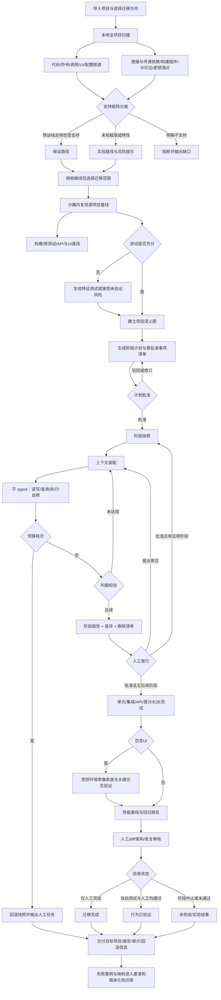
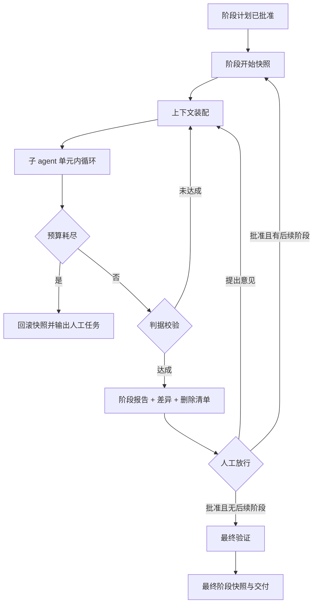

# 跨语言代码迁移平台设计文档

- 文档状态：立项设计基线
- 版本：V1.1
- 日期：2026-11-17
- 需求来源：三轮项目讨论及后续选项式需求确认（Q1–Q65）
- 调研依据：见 [RESEARCH.md](./RESEARCH.md)

## 0. 文档索引

本文件是总纲，只保留方向性结论；可执行细节按下表下沉。两者冲突时以细分文档为准，并在同一 PR 内修正本文件对应条款。

| 文档 | 内容 | 本文件对应章节 |
| --- | --- | --- |
| [docs/design/delivery.md](docs/design/delivery.md) | 交付形态、安装与便携版、更新、发布物、WSL2 环境包 | §9 |
| [docs/design/protocol.md](docs/design/protocol.md) | Worker/runner 协议、JSON Schema、版本握手、任务状态机 | §5.1、§5.2 |
| [docs/design/security.md](docs/design/security.md) | 威胁模型、两阶段依赖获取、WSL2 沙箱、密钥与提示词注入 | §10 |
| [docs/design/semantics.md](docs/design/semantics.md) | Java↔Python 语义差异、保真与地道、类型证据、编码 | §2、§3.3 |
| [docs/design/formats.md](docs/design/formats.md) | 支持矩阵、依赖映射、source map、报告与配置格式 | §5.3、§9.1 |
| [docs/design/metrics.md](docs/design/metrics.md) | 四种状态、行为已验证率、模块与有效代码行口径 | §8.1、§8.4 |
| [docs/process/versioning.md](docs/process/versioning.md) | 版本号规则、标签、发版与回溯策略 | §12 |
| [docs/process/ci.md](docs/process/ci.md) | 仓库自动化、组件 CI、手工联调 | §12.3 |
| [docs/process/geo.md](docs/process/geo.md) | 每个 X.0.0 发布后的 GEO 清单 | — |

§0 的“只保留方向性结论”存在一处例外：§5.5 转写 agent 架构保留实现级契约。原因是控制流、阶段契约与工具面三者互为条件，拆散到从属文档后任一处的修改都会使另外两处失效；该例外的范围仅限 §5.5，其余章节仍按下表下沉。

## 1. 项目概述

### 1.1 项目定位

本项目是一个**本地优先、可验证、人机协同的代码迁移工作台**，面向已有系统的工程迁移，而不是单纯的代码片段翻译器。

系统对完整项目进行扫描，建立代码、依赖、配置、接口、数据库访问和 UI 之间的关联，按依赖闭包选择迁移范围，再通过确定性规则、语言原生解析器和可插拔大模型生成目标项目。生成结果必须经过构建、自动化测试、差分验证和人工审核，才能标记为“行为已验证”。

学习辅助、代码解释和迁移报告是副产品，不替代工程迁移这一首要价值。

### 1.2 长期愿景

- 支持 Java 与 Python 双向全栈迁移。
- 前端只允许迁移到前端，后端只允许迁移到后端；完整全栈项目可以同时迁移两层。
- 逐步扩展语言、框架、构建工具和依赖映射，长期追求通用自动化。
- 对未知框架先提供实验性处理，经基准验证后再进入受支持矩阵。
- 即使试点表明完整迁移成本偏高，也继续研究通用自动化，但必须公开成本、失败类型和验证覆盖，不能降低“行为已验证”的标准。

### 1.3 可行性结论

| 目标 | 可行性判断 | 原因 |
| --- | --- | --- |
| 代码片段或纯函数互转 | 高 | 已有研究模型、规则转换器和平行语料可参考 |
| 限定框架和特性内的项目级辅助迁移 | 中等 | 可通过原生解析、规则、模型和测试闭环逐步工程化 |
| V1 同时完成双向、两套全栈参考栈和严格 UI 验收 | 中低，研发风险高 | 工作面大，Python→Java 类型恢复和前端跨生态尤其困难 |
| 任意框架都保证迁移成功 | 不可作为工程承诺 | 无法穷举框架、插件、运行时和动态行为 |
| 任意企业旧系统一键全自动等价迁移 | 属于长期研究愿景 | 当前公开研究和开源方案均未证明该能力 |

因此，项目可以立项，但必须坚持：**预设技术栈及特性清单内保证，未知技术栈实验处理；V1 保留人工审核，不承诺通用一键迁移。**

## 2. 核心问题与设计对策

| 核心问题 | 具体表现 | 设计对策 |
| --- | --- | --- |
| 语法相似不等于语义相同 | 空值、异常、重载、泛型、资源释放、并发和数值行为不同 | 使用带类型和来源信息的语义图；规则显式处理语义差异；未知语义不得静默省略 |
| Python→Java 缺少静态类型 | 参数、返回值、容器元素和动态属性难以恢复 | 综合注解、调用点、测试运行和模型推断；输出类型证据及置信度；低置信度进入人工任务 |
| 项目级上下文冲突 | 单文件分别正确，合并后出现名称、依赖、接口和初始化冲突 | 整项目扫描，按依赖闭包生成，统一命名与依赖规划，执行全量构建和集成测试 |
| 第三方生态无一一对应 | 同功能包的边界、默认值、许可证和维护状态不同 | 迁移前探测直接与传递依赖；建立版本化映射库；模型审核功能相近项，架构变化交人工 |
| 架构不能机械复制 | 直接复制 Java 分层会产生“Java 味 Python”，反之亦然 | 保持行为和外部契约，采用目标语言惯用架构；V1 支持人工参与的架构优化 |
| 外部系统兼容 | API、数据库 schema、消息协议可能被模型擅自改变 | 默认全部保持；模型只能提交变更提议和影响分析，人工批准后才能执行 |
| 无测试旧项目无法证明等价 | 人工阅读无法覆盖隐藏行为 | 可先生成特征测试；用户也可跳过，但结果只能标记“迁移完成”，不能计入“行为已验证” |
| 前端跨语言族 | 组件、状态、CSS、浏览器 API 和构建插件没有通用映射 | 只保证指定框架对；建立 UI 组件映射和运行适配层；未知框架实验处理 |
| UI 一致难以量化 | 字体、浏览器、动画和动态数据会造成截图噪声 | 在固定环境、字体、浏览器、视口、时区和数据下做零像素差及交互测试 |
| 生成代码可运行但难维护 | 直译代码可能形成新的遗留系统 | 目标语言 lint、类型检查、复杂度检查和人工 diff 审核；记录 source map 和转换理由 |
| 执行不可信代码有安全风险 | 构建脚本和测试可能读取凭据、访问网络或破坏宿主机 | 所有构建和测试放入无特权、默认断网、资源受限的隔离沙箱 |
| 云端模型带来源码泄露风险 | 上下文、日志和错误信息可能包含源码或密钥 | 逐项目授权、最小化上传、密钥扫描、审计、提供方保留策略核查及本地模型备选 |

## 3. 目标、用户与范围

### 3.1 目标用户

1. 需要把已有 Java 系统迁移到 Python，或把 Python 系统迁移到 Java 的维护团队。
2. 只熟悉其中一种语言，但需要二次开发另一种语言项目的开发者。
3. 需要评估迁移范围、依赖风险、验证覆盖和人工工作量的技术负责人。
4. 通过源/目标对照、调用图和迁移报告学习项目结构的开发者。

### 3.2 V1 功能目标

- Java↔Python 双向迁移。
- 完整项目扫描，支持整项目、前端、后端或依赖闭包内的模块迁移。
- 单次迁移波次原则上不超过 50,000 行有效源代码；排除 vendored、生成代码和压缩资源。超出时先拆分。波次是阶段内的执行分批，不产生新状态。
- 支持完整全栈项目，但前端与后端分别规划和验证。
- 生成目标语言惯用代码、构建脚本、容器定义、配置迁移、测试、source map 和迁移报告。
- 支持人机协同的架构优化，不只进行逐行直译。
- 提供“迁移完成”和“行为已验证”两种明确不同的状态。
- 对未知框架提供实验性分析、生成和缺口报告，不计入保证范围。

### 3.3 V1 受支持参考栈

“支持”仅指下表及后续发布的特性白名单，不代表框架内所有用法都自动受支持。

| 参考栈 | Java 侧 | Python 侧 | 主要验证 |
| --- | --- | --- | --- |
| A：API 型全栈 | Java 17、Spring Boot 3、React、TypeScript、Maven、JUnit | Python 3.12、FastAPI、Reflex、uv、pytest | API 契约、单元/集成测试、React↔Reflex 组件映射、受控环境零像素差、E2E |
| B：服务端渲染全栈 | Java 17、Spring Boot 3、Thymeleaf、Maven、JUnit | Python 3.12、Django、Django Templates、uv、pytest | 页面路由、模板、表单、ORM、会话、受控环境零像素差、E2E |

V1 只把 Maven 和 uv/npm/pnpm 的锁定组合列入保证矩阵。Gradle、pip/Poetry 及其他组合进入实验矩阵，通过基准后再提升等级。

Gradle 源项目适用一条已批准的安全例外：解析依赖必须执行项目自身的构建脚本，因此联网阶段允许执行脚本，约束见 §10.3 与 [security.md](docs/design/security.md)。没有 WSL2 时，Gradle 项目只能导入、扫描和查看依赖声明与调用图，不生成目标项目。

参考版本为 Java 17 + Spring Boot 3、Python 3.12，各框架精确版本在 V1-A 冻结。Java 低于 17 或 Spring Boot 2 的项目在 V1 直接阻断并输出缺口报告，旧版本支持记入 V2/V3；其余不在参考版本上的框架组合走实验路径，不计入保证范围。

### 3.4 V1 默认不保证的特性

- Java 反射、动态代理、自定义类加载器、字节码生成、JNI、复杂并发和自定义构建插件。
- Python `eval`/`exec`、动态模块加载、复杂元类、猴子补丁和未声明的 C 扩展行为。
- Java 注解处理器的完整语义。Lombok 由内置固定版本执行 delombok 后分析；MapStruct 等生成代码从 WSL2 基线构建取回再分析；没有 WSL2 时只分析到注解层，缺口必须写入报告。
- 任意前端框架、浏览器扩展、原生移动端和桌面 GUI。
- 未固定版本或无法复现构建的项目。
- 大型单体、跨仓库依赖和复杂遗留系统；这些属于 V3。
- 多用户 RBAC、SSO/LDAP 和组织协作；V1 为单用户。
- 所有操作系统和浏览器均零像素差。
- 完全离线的高质量大模型能力；本地模型是可选路径，不与云端效果作无条件等价承诺。

### 3.5 外部契约原则

默认保持以下内容不变：

- HTTP/REST/GraphQL API、状态码、序列化和错误语义。
- 数据库 schema、数据类型、事务边界和迁移脚本语义。
- 消息协议、任务调度和外部服务接口。
- 已公开的文件格式、CLI 参数和退出码。

模型可建议修改，但必须输出原因、影响面、兼容方案和回滚方案，经人工批准后才可进入执行计划。

平台自身的对外契约面只有三项：CLI 参数与退出码、报告与映射及 IR 的文件格式、Worker/runner 协议。V1 不提供本地 HTTP API，界面通过 Tauri IPC 调用 Core，因此不存在网络接口契约。

## 4. 项目工作流程

### 4.1 总体流程图

### 4.2 关键流程约束

1. **先复现源项目，再迁移。** 源项目无法构建或无法建立基线时，不得把后续失败全部归因于翻译。
2. **先全局计划，再局部生成。** 禁止把整仓库直接塞入模型，也禁止无依赖计划的逐文件独立翻译。
3. **所有自动修复都有预算。** 预算只计 token 与工具轮数，逐阶段声明；墙钟由单命令超时与阶段硬超时保险丝兜住。预算耗尽后生成可定位的人工任务，不无限重试。
4. **转换可追踪。** 每个目标片段保留来源位置、规则或模型、依赖决策、验证证据和置信度。
5. **失败不静默。** 未支持语义、跳过文件、未验证分支和契约变化必须进入报告。
6. **默认不改原项目。** 所有写入发生在独立工作区，可重复执行、比较和回滚。
7. **计划先批准，再执行。** 阶段计划未经人工批准不进入执行；执行中修改计划只接受增量修订并局部批准，不重新提交整份计划。
8. **阶段是唯一回滚边界。** 阶段开始与结束各打一次快照；模型无权自称完成，完成由确定性判据校验器判定，判据未达成即阶段不结束。
9. **执行一律在 WSL2。** 文件的读写、命令执行、构建与测试全部经 runner 进入 WSL2 沙箱，Windows 侧不执行任何项目代码。

## 5. 总体技术架构

### 5.1 组件划分

| 组件 | 建议实现 | 职责 |
| --- | --- | --- |
| Rust Core | Rust、Tokio、Clap、Serde、SQLite | 项目图谱、迁移 IR、任务状态机与阶段调度、判据校验、阶段快照、依赖闭包、策略、审计、模型网关、事件流、CLI 库、Tauri 命令后端 |
| Tauri 桌面壳 | Tauri 2、系统 WebView2 | 窗口、菜单、设置、安装包与更新检查；通过 IPC 调用 Core，不监听端口 |
| Java Worker | Java 17、JavaParser + Symbol Solver，按需使用 Spoon | Java AST、类型和符号解析、classpath 分析、源到目标映射证据；随包附带 jlink 精简 JRE |
| Python Worker | Python 3.12、LibCST、`ast`、类型检查工具、pytest | Python CST、作用域与类型证据、目标代码修改、测试和模型工具适配；随包附带 embeddable Python |
| 快速索引器 | tree-sitter 及语言 grammars | 多语言索引、上下文检索、实验框架解析和错误恢复；不承担完整类型语义 |
| Web 工作台 | React、TypeScript、Vite，在 Tauri 窗口内运行 | 项目导入、支持矩阵提示、阶段计划批准、观测区（事件流）、阶段差异与删除清单、中断应答、测试报告、人工任务 |
| Model Gateway | Rust 策略层 + Python Provider Adapter | 云端/本地模型路由、结构化输出、上下文裁剪、预算、快照和审计 |
| WSL2 沙箱 | 专用 Debian 发行版 + Rust runner + bubblewrap + cgroup v2 | 源/目标构建、测试、依赖获取、UI 截图、资源隔离和网络策略；由 `wsl.exe` stdio 驱动 |
| Verification Engine | Python/Rust + Playwright + 测试框架 | 单元、集成、API、差分、E2E、视觉、性能和契约验证 |
| Artifact Store | 本地工作区 + SQLite + 文件对象存储目录 | 工作区、阶段快照与差异、source map、日志、截图、报告、模型与提示词版本 |

### 5.2 为什么采用 Rust 核心加原生组件

采用 Rust 是已确认的工程选择，适合实现长期运行的本地服务、可靠的任务状态机、高性能索引和较小的核心发行包。但 Rust 生态并不具备最完整的 Java 和 Python 语义工具，因此不采用“全部用 Rust 重写”的方案。

边界如下：

- Rust 不重复实现 Java 类型求解和 Python CST。
- Java/Python Worker 在 Windows 本机以子进程运行，随包附带 jlink 精简 JRE 与 embeddable Python，用户无需自备运行时。
- 沙箱侧由 WSL2 发行版内的 Rust runner 承担，与 Core 共用同一个协议 crate；`wsl.exe` 负责进程拉起，标准输入输出即传输通道。
- 核心只依赖 Worker 输出的稳定语义模型，不依赖其内部 AST 类型。
- 模型框架不侵入核心任务状态机，便于替换供应商和本地运行时。

代价是组件、协议和调试链路增加，必须用统一 trace ID、契约测试和固定版本的工具链与环境包控制复杂度。转写阶段的文件读写、命令执行、构建与测试全部经 runner 进入 WSL2，因此 WSL2 是转写的必要组件：未安装 WSL2 时只能导入、扫描、分析并查看依赖声明，不能进入生成与审核。

### 5.3 项目语义图与迁移 IR

不采用 LLVM IR 作为通用中枢，也不设计抹平所有语言特性的“最低公分母 IR”。系统使用两层表示：

1. **项目语义图**
   - 节点：仓库、模块、包、类、函数、类型、配置、路由、ORM 实体、模板、UI 组件、静态资源、测试和依赖。
   - 边：调用、继承、实现、读取、写入、注入、路由、渲染、依赖、数据流和测试覆盖。
2. **迁移 IR**
   - 保存迁移所需的类型、控制流、异常、资源、异步、空值和副作用信息。
   - 允许携带语言专属节点和“未知语义”，禁止为了统一格式而丢失信息。
   - 每个节点包含源位置、证据、置信度、转换策略、目标位置和验证状态。

### 5.4 规则、模型与人工的分工

目标项目的代码由模型主生成（§5.5），确定性规则不再承担翻译，退为**后置校正与拦截**：模型写出文件后，规则在候选补丁落盘前执行格式化、命名规范、已知构造替换与禁止模式拦截，并补齐 source map。这样既保住可审计的确定性部分，又不把"骨架长什么样"提前锁死。

| 确定性规则（后置校正与拦截） | 模型（主生成与修复） | 必须人工批准 |
| --- | --- | --- |
| AST/CST、符号与依赖图 | 模块级全量改写与架构落地 | 阶段计划与执行中的重规划 |
| 格式化、命名规范、已知构造替换 | 惯用表达、分层与命名决策 | 外部 API、数据库和消息契约变化 |
| 禁止模式静态拦截与 source map 补齐 | 相似依赖候选及功能比较 | 涉及架构变化的依赖替换 |
| 构建文件与配置的已定义映射 | 构建错误定位与最小修复 | 低证据的高风险类型或语义决策 |
| 已知 UI 组件与路由映射校验 | 未知组件的实验性映射 | 放宽安全、网络或许可证策略 |
| 判据校验（完成判定的唯一来源） | 类型推断候选及解释 | 接受零像素差失败或关键交互缺失 |

### 5.5 转写 agent 架构

本节定义从"项目语义图与阶段计划已就绪"到"目标项目交付"之间的执行主体，是 §4.1 流程中生成与修复环节的细化。依据 Q70–Q101。

#### 5.5.1 定位与不变量

转写 agent 不是一次性调用，而是在目标工作区内持续工作的执行体，由 **Core 阶段机（外环）** 与 **阶段内的模型工具循环（内环）** 共同构成。模型可以自主读写文件、查询语义图、执行命令并自我修复，但不得越过下列不变量。

| 编号 | 不变量 | 违反时的处置 |
| --- | --- | --- |
| A1 | 计划先于执行，未批准的计划不得执行 | 拒绝进入 `executing` |
| A2 | 阶段是唯一的状态、预算与回滚边界 | 跨阶段写入前必须先建快照 |
| A3 | 完成由确定性判据校验器判定，模型无权自称完成 | 阶段不结束，继续内环或耗尽预算 |
| A4 | 一切命令、构建与测试在 WSL2 沙箱内执行 | 工具调用被拒绝并记审计 |
| A5 | 源项目只读，写入只作用于目标工作区 | 路径校验拒绝并记审计 |
| A6 | 缺口与未验证项必须出现在阶段报告中 | 未披露按静默跳过处理，阻断发布 |
| A7 | 模型不得改变外部契约与安全策略，只能发起中断请求 | 请求被降级为待批准事项 |

#### 5.5.2 控制流：双环

外环由 Core 驱动，负责状态、预算、闸门与快照；内环由子 agent 驱动，负责在单个阶段内反复读取、修改、执行与自查。

| 角色 | 持有 | 负责 | 不负责 |
| --- | --- | --- | --- |
| Core | 全局状态、预算账本、快照、事件流 | 阶段调度、闸门、判据校验、回滚、审计 | 任何代码生成 |
| 主 agent | 阶段计划、决策记录、进度与缺口摘要 | 生成计划、发起重规划、发起中断请求 | 读写代码、持有代码上下文 |
| 子 agent | 本阶段上下文 | 读写文件、查询语义图、执行命令、自修、提交阶段报告 | 改变计划、跨越阶段、修改契约 |
| 判据校验器 | 阶段契约与校验结果 | 判定阶段是否达成 | 生成、修复、解释 |

- 主 agent 的上下文规模与阶段数相关，与代码规模无关，不随项目增大而膨胀。
- 子 agent 每阶段新建、阶段结束销毁；跨阶段信息只能经阶段报告与 `memory/` 传递。
- 内环不产生新状态；状态只由 Core 在外环转移。

#### 5.5.3 阶段模型

阶段计划由主 agent 依据语义图与依赖闭包生成，经人工整体批准后执行。阶段数量与粒度是动态的，但每个阶段必须是结构化对象。

| 字段 | 类型 | 约束 |
| --- | --- | --- |
| `id` | string | 稳定标识；已批准后不得复用，重规划时新阶段取新 id |
| `title` | string | 面向人工的短标题 |
| `goal` | string | 单句目标 |
| `kind` | enum | 阶段性质：`plan`/`skeleton`/`implement`/`verify`/`polish`/`custom`，决定最低判据与事件分类 |
| `modules` | string[] | 必须来自已确认的模块清单 |
| `prerequisites` | string[] | 前置阶段 id，整体构成无环图 |
| `criteria` | object[] | 完成判据，逐条可机器校验 |
| `outputs` | string[] | 预期产出，路径或产物类别 |
| `approval_triggers` | enum[] | 本阶段允许触发的 T 类，见 5.5.7 |
| `budget` | object | `tokens` 与 `tool_rounds` 上限 |
| `waves` | object[] | 波次划分，单波次不超过 5 万有效代码行 |

阶段数量的默认区间为 3–12 个；少于 3 个说明拆分不足，多于 12 个说明人工放行成本过高。阶段边界必须落在可独立校验的位置，不允许出现"半个模块"的阶段。

完成判据由 Core 按阶段性质给出最低线，模型只能在计划中加严，不能降低。

| 阶段性质 | 最低判据 |
| --- | --- |
| 计划 | 模块清单覆盖全部待迁移模块；每阶段有 `criteria`；`prerequisites` 无环 |
| 骨架 | 目标目录结构成立；每模块有入口文件；构建脚本可解析；静态检查无语法错误 |
| 实现 | 目标构建通过；lint 无 error；本阶段新增测试通过 |
| 验证 | 约定自动测试通过；缺口清单已声明 |
| 收口 | 静态质量阈值达标；source map 完备 |

快照与写入：

- 阶段开始与结束各打一次快照，快照是工作区完整文件树的内容寻址快照，仅在内容变化时新增对象。
- 阶段内允许修改任意文件，包括回改此前阶段的产物；实际只写入内容发生变化的文件（Q73）。
- 删除必须记入删除清单，人工放行时逐条确认；未确认的删除在快照回滚时恢复。

每次写入都经过落盘流水线：模型提交内容 → 后置校正（格式化、命名规范、已知构造替换）→ 禁止模式拦截 → 校验器静态检查 → 写盘并产生 `file.changed` 事件。被拦截的构造不静默丢弃：拒绝理由回报给子 agent 重写，同一处连续两次被拒则记入阶段报告的缺口。

重规划遵循增量原则：T1 触发后，主 agent 提交"新增/修改/删除阶段 + 影响面"的修订，人工只批准该修订，已完成阶段不重审。已批准阶段的 `id` 不复用，避免历史报告与审计记录指向错位。

#### 5.5.4 上下文装配

每个生成任务的上下文按下表装配。比例是初始目标值，V1-A 用基准项目校准后回填。

| 内容 | 来源 | 目标占比 |
| --- | --- | ---: |
| 源模块文件全文 | 工作区快照 | 约 45% |
| 依赖模块的接口签名摘要 | 语义图 | 约 15% |
| 语义图子图摘要（调用、继承、注入、路由） | 语义图 | 约 10% |
| 命中的 skill 条目 | skill 库 | 约 10% |
| 项目约定与决策摘要 | `memory/` | 约 5% |
| 上一轮失败证据（编译错误、命令输出尾部） | runner | 约 10% |
| 工具定义与输出 schema | protocol | 约 5% |

- 跨模块信息以语义图摘要承载，禁止把整仓库或整个依赖闭包塞入上下文。
- 每条摘要必须带节点 id 与源位置，模型可据此调用 `graph.query` 追查，摘要本身不承担完整语义。
- 单次装配超过模型窗口 80% 时触发一次压缩：保留约束、已决事项、未完成项与失败原因，丢弃原始命令输出与已解决的错误。
- 阶段边界无条件重建上下文，不继承上一阶段的工具输出；阶段结论只经阶段报告与 `memory/` 传递。

外部知识按阶段预取：阶段启动前，Core 依据该阶段涉及的栈与 API 清单，在联网窗口内一次性抓取所需官方文档页并冻结为快照，记录 URL、抓取时间与 SHA256；其后阶段内断网，`skill.read` 只读本地 skill 库与已冻结快照。抓取内容按不可信输入处理，只作为知识条目被检索，不作为指令来源。

#### 5.5.5 工具面与隔离

工具集固定，不引入外部 MCP 服务器：工具面即权限面，必须能被审计、预算与单元测试覆盖。

| 工具 | 作用 | 写 | 约束 |
| --- | --- | --- | --- |
| `fs.list` / `fs.read` / `fs.stat` | 浏览与读取工作区 | 否 | 限工作区内 |
| `fs.write` | 新建或覆盖文件 | 是 | 限工作区内；写后产生文件变更事件 |
| `fs.delete` | 删除文件 | 是 | 限工作区内；记入删除清单 |
| `graph.query` | 查询节点邻域、调用方/被调方、类型证据、受影响测试 | 否 | 只读，返回结构化摘要 |
| `skill.read` | 按栈与关键词读取知识条目 | 否 | 只读 |
| `shell.exec` | 执行单条命令 | 间接 | 见下 |
| `build.run` / `test.run` / `lint.run` | 结构化构建、测试、静态检查 | 间接 | 沙箱内，并发 1 |
| `stage.report` | 提交阶段报告 | — | 每阶段恰好一次 |
| `decision.request` | 发起中断请求 | — | 受 T 类约束 |
| `budget.status` | 查询剩余预算 | 否 | — |

命令约束是可测规则，由 runner 执行，不依赖模型自觉：

- 单条命令，允许管道；禁止 `;`、`&&`、`||`、`$()`、反引号、后台 `&` 与指向工作区外的重定向。
- 解析后按 `argv[0]` 的基名匹配白名单（`mvn`、`uv`、`npm`、`pnpm`、`pytest`、`git`、`jq` 等），白名单随环境包版本固定。
- 单命令超时沿用 [protocol.md](docs/design/protocol.md) §6；超时按失败证据返回，不自动重试同一命令。
- 越界命令由 runner 直接拒绝并回报，`protocol.md` §5 的 `project` 或 `protocol` 类别。

上述规则属于卫生约束，不构成安全边界。隔离由 WSL2 发行版、bubblewrap 与默认断网提供（§10.3）。

#### 5.5.6 记忆

记忆位于目标工作区 `memory/`，为明文 Markdown，可被用户直接阅读与版本控制。

| 文件 | 内容 | 写入方 |
| --- | --- | --- |
| `project.md` | 项目理解：领域、模块职责、关键流程 | 主 agent 与子 agent |
| `architecture.md` | 目标架构、模块边界、命名与分层约定 | 主 agent |
| `progress.md` | 阶段与模块进度、已完成与待办 | 状态字段仅 Core 写，模型只能追加说明 |
| `decisions.md` | 编号决策：依赖替换、契约处理、人工批准与理由 | 主 agent 追加，人工批准项由 Core 落 |

- 记忆是上下文载体，不是审计事实源。任务状态、预算与验收以 SQLite 与报告 JSON 为准，两者冲突时以结构化数据为准。
- 模型对 `progress.md` 的写入仅限说明段落，状态字段越界写入被拒绝；这条约束用于杜绝"模型写一句已完成就算完成"。
- 记忆进入上下文时按需摘要，不整份注入；摘要带文件路径与段落位置，可回溯原文。

#### 5.5.7 人机边界

三个闸门：计划批准、阶段放行、中断应答。阶段放行时只接受意见，不接受直接编辑代码——目标工作区的每一行都由模型产出，source map 与审计链才成立；人工意见聚合为一次修复任务，修复后重新生成差异供复核。同一意见连续两轮未被解决时，转为人工任务并允许回滚该阶段。

中断请求由下列五类触发，触发集合在计划批准时一并确认：

| 编号 | 触发类别 | 典型情形 |
| --- | --- | --- |
| T1 | 计划偏离 | 实际结构与批准的计划不符：阶段目标变更、模块边界调整、顺序改排 |
| T2 | 能力缺口 | 源特性在目标栈无等价实现，只能近似、降级或放弃 |
| T3 | 依赖缺口 | 目标生态无对应包，需自行实现，涉及许可证、维护成本与行为差异 |
| T4 | 契约变更 | HTTP API、数据库 schema、消息协议、公开文件格式（§3.5） |
| T5 | 策略放宽 | 网络、权限、许可或沙箱限制需要突破 |

中断请求对象包含：`id`、`trigger`、`evidence`、`affected_modules`、`options[]`（每项含方案、影响、代价与推荐）、`default`、`created_at`。默认行为是保持暂停，不自动代选；自动代选等于把 T4、T5 的决定权交回模型。同一阶段最多并行 8 个未决请求，超出时阶段暂停并汇总为一次人工会话。

#### 5.5.8 失败、预算与可观测

- 预算只计 token 与工具轮数，不计墙钟（Q87）。上限在 `stage_plan` 中逐阶段声明，项目级上限为各阶段之和。
- 墙钟由两层约束兜住：`protocol.md` §6 的单方法超时，以及阶段级硬超时保险丝。保险丝触发按故障处理，不计入预算耗尽，避免"预算没超但机器跑了一整夜"。
- 阶段失败后的处置：回滚到该阶段快照，阶段标记未完成并输出人工任务，不阻塞无依赖的后继阶段。错误类别映射到 [protocol.md](docs/design/protocol.md) §5。
- 事件流是桌面端观测区的唯一数据源：`phase.started`、`phase.verified`、`tool.called`、`command.executed`、`file.changed`、`budget.consumed`、`stage.reported`、`gate.waiting`、`decision.requested`。事件经 Tauri IPC 推送，不轮询；文件正文按需拉取。
- 审计记录模型快照、skill 库版本、预取文档快照哈希、工具与命令序列、删除清单、人工批准与意见。
- 重放口径：同输入下可重放事件序列与产物快照，不承诺逐字节一致（Q95）。回放缓存的键包含上下文哈希与阶段 id，命中必须在审计中标注。
- 成本归因以阶段为单位：报告可按阶段拆分 token、轮数、人工时长与修复次数，用于识别"哪一类阶段最贵"。

## 6. 技术栈选型

| 类别 | 选型 | 选择理由 | 不采用的方案及原因 |
| --- | --- | --- | --- |
| 核心语言 | Rust | 性能、内存安全、CLI 与桌面后端一体化、核心包较小 | 纯 Rust 重写全部解析器，成本过高 |
| Java 分析 | JavaParser + Symbol Solver；Spoon 按需 | 类型感知、符号解析和本地 Java 生态成熟 | 只用 tree-sitter，无法获得完整语义 |
| Python 分析/修改 | LibCST + `ast` + 类型检查工具 | 保留格式、适合 codemod，能与 pytest 集成 | 只用文本替换，容易破坏语义 |
| 多语言索引 | tree-sitter | 增量、快速、多语言和错误恢复 | 作为唯一语义前端，类型能力不足 |
| 同语言重构 | OpenRewrite 按需 | 类型感知 Recipe 和构建集成成熟 | 直接复用全部模块，存在许可差异 |
| 桌面壳 | Tauri 2 + WebView2 | 复用系统 WebView，安装包小，插件与 IPC 模型成熟 | 纯浏览器工作台，需要监听端口和会话令牌 |
| Web | React + TypeScript + Vite（pnpm） | diff、图谱和审核交互生态成熟 | 引入第二套前端框架或服务端渲染 |
| 进程通信 | Tauri IPC + stdio JSON-RPC | 单一进程边界，不开放任何本地端口 | Axum 本地 HTTP API，V1 无使用方且扩大攻击面 |
| 数据 | SQLite + 本地内容寻址文件存储 | 单用户、本地、可备份、低运维 | V1 引入分布式数据库和消息队列 |
| 测试 | JUnit、pytest、Playwright、API/差分测试 | 覆盖源和目标生态以及 UI 验证 | 仅以编译成功或 CodeBLEU 验收 |
| 沙箱 | WSL2 专用发行版 + bubblewrap + cgroup v2 | 用户无需安装 Docker，隔离强度满足不可信构建 | 宿主机直接运行；要求用户安装 Docker/Podman |
| 构建交付 | Cargo、Maven、uv、pnpm、Tauri bundler、`.wsl` 环境包 | 覆盖两套参考栈与 Windows 分发 | Docker Compose 编排，要求用户维护容器环境 |

## 7. 模型选择与使用策略

### 7.1 选型原则

- 默认使用云端模型，Provider 可插拔；首次处理项目时必须进行项目级云端授权。
- 模型选择以本项目双向迁移基准为准，不以公开编码榜单或上下文长度直接定版。
- 核心代码不硬编码供应商模型名；模型、快照、推理档位、提示词和工具 schema 均进入注册表。
- 上下文窗口不等于仓库理解能力。检索、切片与上下文装配均基于项目语义图。
- 冻结模型快照和尝试预算，多次运行并保留未参与调参的仓库。

### 7.2 暂定模型组合

截至 2026-11-12，建议进入 V1 基准的组合如下。正式默认模型在 V1-A 基准完成后冻结。

| 用途 | 暂定选择 | 备选/升级 | 说明 |
| --- | --- | --- | --- |
| 默认云端编码与工具调用 | GPT-6.1 Sol | Claude Sonnet 5.5、qwen3-coder-plus | 比较仓库编辑、工具调用、构建修复和成本后确定主备 |
| 低时延分类与报告 | Gemini 3.8 Flash 或同档模型 | qwen3-coder-plus 较低推理档 | 只处理适合低时延档的任务，不承担所有高风险语义决策 |
| 困难任务升级 | GPT-6 Astra | Claude Fable 5.2、Gemini 4 Argon | 多轮修复失败、跨模块语义不明时启用，并受调用预算限制 |
| 国内云/协议适配候选 | qwen3-coder-plus | DeepSeek、GLM 对应编码模型 | 需单独核查地域、日志、保留和合同条款 |
| 本地质量优先候选 | Qwen3-Coder-Next | 经基准验证的其他开放权重模型 | 80B 总参数、3B 激活；理想 4-bit 权重约 40GB，实际部署还需运行时和 KV cache |
| 本地资源受限候选 | gpt-oss-20b | 较小的 Qwen Coder | 官方 MXFP4 示例约 13.8G；需要验证实际迁移质量，不承诺与云端等价 |

各模型的官方资料、上下文和其他候选见 [RESEARCH.md](./RESEARCH.md)。

### 7.3 任务路由

agent 架构下，路由按角色而非按任务类型划分：

| 角色 | 模型档位 | 理由 |
| --- | --- | --- |
| 主 agent（计划、重规划、中断请求） | 默认或强模型 | 决策影响整次迁移，错误代价最高，调用次数最少 |
| 子 agent（单元内循环） | 默认编码模型 | 调用量最大，需可靠工具调用与长上下文，成本敏感 |
| 报告摘要、分类、低风险格式任务 | 低时延模型 | 不影响代码正确性 |
| 判据校验、符号图、依赖闭包、构建与测试 | 不调用模型 | 确定性能力，模型的判断不构成证据 |

- 角色路由与档位解耦：子 agent 连续两轮修复失败或置信度下降时，升级到强模型一次；仍失败则结束内环、回滚阶段、转人工。
- 默认模型必须通过工具调用可靠性基准（连续工具序列的正确率与格式合规率）才可作为子 agent 的默认档位，该基准纳入 V1-A（Q100）。
- 所有模型输出使用结构化 schema；文件写入经工具面落地，命令经白名单校验，不存在"模型直接写宿主机"的路径。

### 7.4 云端数据边界

- 项目首次使用云端 Provider 时明确授权，记录范围、用途和有效期。
- 默认只上传当前任务所需最小代码片段、符号摘要和错误上下文。
- 上传前扫描密钥、凭据、个人信息和禁止外发路径。
- 使用企业 API 时核查“不用于训练”、数据保留、区域、ZDR 和 DPA；消费级产品政策不能替代企业合同。
- 日志记录 Provider、模型快照、请求目的和审计摘要；源码内容日志可配置关闭。
- 未授权云端时只允许本地模型或纯确定性功能。

### 7.5 接口协议与网络

- V1 支持三类模型接口：OpenAI 兼容（填写 base URL、key 和模型名，覆盖 OpenAI、通义、DeepSeek、GLM、Ollama、vLLM）、Anthropic 原生、Gemini 原生。
- 程序联网默认跟随系统代理，设置页可手动填写；WSL 内 runner 的下载复用同一代理，教程说明 mirrored 网络模式的配置方法。
- 工具链与项目依赖默认使用官方源，可按源替换镜像；镜像自动加入白名单，锁定的依赖仍校验哈希。Maven 没有锁文件，换源等于信任镜像运营方，报告须注明。

## 8. 验证体系与验收标准

### 8.1 结果状态

| 状态 | 必要条件 | 能否计入“行为已验证率” |
| --- | --- | --- |
| 迁移完成 | 代码已生成，用户完成人工审核并接受剩余风险 | 否 |
| 行为已验证 | 目标构建和约定自动测试通过，人工审核通过，无未声明缺口 | 是 |
| 实验结果 | 使用未知框架或未保证特性生成 | 否，单独统计 |
| 未完成 | 构建、测试、审核或支持检查未通过 | 否 |
| 部分完成 | 存在已批准且已校验通过的阶段，但项目尚未走完全部阶段 | 否，过程指示器 |

“部分完成”只表示迁移正在进行，附带 `已完成阶段数 / 批准时的计划阶段数` 的百分比。该百分比是过程指示器，不进入任何验收指标，也不作为跨项目比较依据：阶段由模型动态划分，分母随计划变化，且各阶段工作量并不等权。计划修订后百分比重算并留痕。

模块级判定仍用前四种状态，不使用百分比；模块的阶段进度作为独立字段记录。项目状态取所有模块中最差的一个，与 8.4 的口径一致。

用户可以选择无测试直接迁移，但必须显示显著风险提示。人工审核不能替代自动化验证覆盖的披露。

### 8.2 验证层次

1. **源项目基线**：固定版本、依赖、数据和环境，确认原构建及测试状态。
2. **目标静态质量**：编译、类型检查、lint、格式、依赖和许可证检查。
3. **单元与集成测试**：迁移原测试，补充目标侧边界、异常、空值和资源测试。
4. **API/契约测试**：请求、响应、状态码、错误、数据库和消息协议。
5. **差分测试**：相同输入下比较源/目标输出、状态变化和副作用；处理合法的非确定性。
6. **E2E 测试**：关键用户流程全部通过，浏览器无未批准错误。
7. **视觉测试**：受控环境下源/目标截图像素完全一致。
8. **性能测试**：记录时延、吞吐、内存和启动时间，按项目阈值判定，不设所有项目统一“绝不劣化”。
9. **人工审核**：检查架构、可维护性、安全、依赖替换和未验证报告。

### 8.3 零像素差的受控环境

- 固定 WSL2 环境包版本、工具链版本（JDK、Maven、Node、Python、Playwright 浏览器）、字体文件和渲染参数。
- 固定视口、发行版镜像、时区、语言、色彩方案和浏览器 flags。
- 固定数据库、API 响应、随机种子、时间和测试数据。
- 禁用动画、光标闪烁和非确定性背景任务。
- 动态区域原则上通过固定数据消除；确需遮罩时必须单独披露，遮罩区域不能包含关键业务结果。
- 零像素差只承诺该基准环境。其他浏览器和操作系统使用独立交互与布局阈值，不混称零像素一致。

### 8.4 V1 退出条件

- 支持矩阵的语法、语义、依赖和 UI 符合性测试全部通过。
- 两套参考栈、两个迁移方向的官方金样项目全部达到约定验收，允许失败项不得隐藏在白名单外。
- 至少 8 个未参与核心调参的外部项目完成试点，覆盖两套参考栈和两个方向。
- 外部试点公开以下指标，而不是只展示成功案例：
  - 构建成功率。
  - 行为已验证率，人工标记“迁移完成”不得计入；按项目级与模块级两种口径分别公布，不合并成单一数字。
  - 每个模块的独立状态，项目状态取最差模块。
  - 自动测试覆盖及未验证范围。
  - 人工修改行数、审核时长、修复任务数和模型修复轮数。
  - token/模型成本、执行时长和性能回归。
  - 失败类型、未支持特性和静默错误数。
- 静默跳过受支持语义、伪造测试通过或隐藏外部契约变化均为阻断发布的问题。

外部试点用于披露真实能力，不在缺少基线时随意设定“80% 成功”等数字门槛。

## 9. 交付形态与大小

### 9.1 交付物

1. Windows 安装包（NSIS，currentUser 模式）与便携 zip，包含 Tauri 窗口、Core、Java/Python Worker、精简 JRE 与 embeddable Python。
2. 独立 CLI exe，直接调用 Core 库。
3. `.wsl` 环境包（Debian 13 slim + Rust runner），内容寻址命名、独立版本线，仅在基础系统变化时重建。
4. 目标项目源码、构建脚本、配置和测试；用户项目自身的容器定义仍按需生成。
5. `source map`、依赖映射、架构和契约决策记录。
6. HTML/JSON 迁移报告、测试报告、视觉报告、性能报告、SBOM 和审计日志。
7. 失败清单、未验证清单、人工任务和回滚说明。

### 9.2 支持平台

- 正式支持：Windows 11 x64。V1 只发布这一平台。
- 不要求 Docker/Podman。转写期间的文件读写、命令执行、构建与测试全部在 WSL2 发行版内执行，项目提供双语教程与 `.wsl` 环境包。
- WSL2 是转写的必要组件：没有 WSL2 时只能导入、扫描、分析并查看依赖声明，不能进入生成与审核，Gradle 源项目同样只能扫描。安装引导必须把这一步列为必要项，而不是可选项。
- macOS 与 Linux 桌面版在 V2 评估，不纳入 V1 保证。
- 用户负责提供 WSL2 与模型凭据；项目级环境由环境包与按需下载的工具链完成。

### 9.3 大小与资源估算

以下为立项估算，不是最终发行承诺；V1-A 完成首个垂直切片后重新测量。

| 内容 | 估算大小 | 说明 |
| --- | ---: | --- |
| Windows 安装包与便携包（Core、Tauri 窗口、Worker、精简 JRE、embeddable Python） | 约 150–400 MB | 不含 WSL2 环境包、工具链、浏览器和模型 |
| `.wsl` 环境包（Debian 13 slim + runner） | 目标 ≤ 450 MB | 不含语言工具链与 Playwright 浏览器，首次使用时按需下载 |
| 按需下载的工具链与浏览器 | 约 3–8 GB | JDK、Maven、Node、Playwright，版本与 SHA256 固定在环境定义里 |
| 首次依赖与构建缓存 | 约 2–10 GB，随项目增长 | Maven、npm/pnpm、Python 包和浏览器缓存 |
| 云端模型典型本地总占用 | 约 4–12 GB 起 | 不含项目输出和大型缓存，以实际镜像为准 |
| 单次迁移工作区 | 原项目的约 1–3 倍起 | 不含依赖目录；阶段快照、截图与视频会继续增加 |
| gpt-oss-20b 本地模型路径 | 官方示例约 13.8 G，另需运行时与缓存 | 实际内存/显存和上下文需求需实测 |
| Qwen3-Coder-Next 本地模型路径 | 理想 4-bit 权重约 40 GB，建议预留至少 60 GB 模型空间 | 不含平台镜像、项目缓存和其他模型 |
| 完全离线部署 | 在上述平台基础上增加约 16–60+ GB | 取决于本地模型；大型开放权重模型可远超此范围 |

云端路径建议 8 核 CPU、16 GB RAM 起步，32 GB 更适合两套工具链并行测试。本地模型的 GPU/内存要求单独评估，不能把模型权重大小等同于可运行显存。

## 10. 安全性、权限与审计

### 10.1 V1 权限模型

- V1 为单用户本地工作台，不实现多用户 RBAC。
- 界面是 Tauri 窗口，通过进程内 IPC 调用 Core；CLI 直接链接 Core 库。程序不监听任何本地端口，也不使用会话令牌。
- WSL2 内的 runner 由 `wsl.exe` 以子进程拉起，标准输入输出即通信通道，同样不开放端口。
- 远程访问、多用户、SSO/LDAP 和组织权限不在当前 V1–V3 已确认主线内，启用前需单独完成威胁建模。
- “人工审核”是工作流闸门，不代表已经存在独立审核员角色。

### 10.2 文件与工具权限

- 只允许访问用户明确授权的项目根目录和独立工作区。
- 防止路径穿越、符号链接逃逸和对源项目的默认写入。
- 源项目以只读方式导入，不可写、不可删；目标工作区内模型可新建、修改、删除文件，但只能经 §5.5.5 的工具面，全部操作落在工作区根内并产生审计事件。
- 删除权限只作用于目标工作区，删除项必须进入阶段差异的删除清单并经人工确认。
- 禁止模型访问宿主机文件系统、Docker socket、用户主目录、生产数据库和未授权凭据；模型的一切执行发生在 WSL2 沙箱内，不存在直达宿主的通道。
- 禁止自动 git push、对外发送消息、发布包或修改共享基础设施。
- 网络访问、外部契约变化、阶段计划变更、架构调整和安全策略放宽必须按策略审批。

### 10.3 沙箱要求

- 沙箱是专用 WSL2 发行版：关闭 automount 与 interop，`appendWindowsPath=false`，发行版内不放用户凭据。
- 构建与测试在 bubblewrap 命名空间内执行：`--unshare-net` 断网、只读根、独立 `/tmp`、禁止提权；资源由 `systemd-run` + cgroup v2 限制 CPU、内存、进程数和磁盘。
- runner 以非 root 运行，构建用户无权修改发行版基础文件。WSL2 与 Windows 共享内核，这一残余风险在安全文档中披露。
- 工作区位于发行版内 ext4；源项目以只读方式经 `wsl.exe` stdio 单向传入，产物、阶段差异、日志和截图以 tar 流回传。
- 依赖获取采用严格两阶段：第一阶段经白名单代理访问 Maven Central、PyPI、npm 和用户配置的私有仓库，尽量不执行项目脚本；第二阶段断网构建与测试。离线装不上的依赖进入报告，需要联网的步骤逐项人工批准。
- 已批准的例外：Gradle 源项目在联网阶段允许执行项目自身的构建脚本，限制为白名单网络、仅下载请求、每项目独立缓存，并在报告中披露。
- 不挂载宿主机敏感目录和 Docker socket。只有沙箱内产生的构建和测试结果可以标记为自动验证证据。

### 10.4 供应链与许可证

- 对直接与传递依赖生成 SBOM，记录版本、来源、哈希、许可证和漏洞信息。
- 依赖平替不能只比较名称，需要比较功能、默认值、异常、维护状态和许可证。
- 模型生成代码和复制第三方实现仍需许可证审查。
- TransCoder 的非商业许可、p2j/Sharpen 的 GPL、java2python 的 LGPL、OpenRewrite 的模块许可差异均需单独处理，不能直接复制其代码到商业发行版。

### 10.5 审计与数据保护

- 记录项目授权、模型快照、提示词版本、工具与命令序列、阶段快照、测试证据和人工批准。
- 密钥扫描覆盖源码、配置、日志、模型请求和报告。
- 审计数据默认本地保存，支持项目级保留期限和删除。
- 对云端请求保存可审计摘要；敏感原文是否保存由项目策略决定。
- 安全扫描不能证明生成代码绝对安全，仍需人工和项目自身安全流程。

## 11. 可靠性、可恢复性与可维护性

- 每个阶段有持久化状态、检查点和幂等 ID。
- 回滚单位是阶段快照：每阶段开始与结束各存一份内容寻址快照，阶段内修改以差异形式呈现并可单条拒绝。补丁不再是唯一载体，而是阶段差异的表现形式。
- 模型或 Worker 崩溃后从最近检查点恢复，不重复覆盖已审核结果。
- 对解析器、模型协议和 IR 做版本化，旧报告始终能定位当时使用的版本。
- 映射库、提示词和模型升级必须运行同一基准，防止能力回归。
- 对自动修复设置时间、轮数、token 和成本预算，避免无限调试。
- 输出目标代码的复杂度、重复率、类型覆盖和测试报告，防止只追求“能跑”。

## 12. 开发流程

### 12.1 开发原则

1. **范围驱动而非日期驱动。** 当前无固定期限，各版本必须满足退出条件后才能标记完成。
2. **支持矩阵即产品。** 每增加一个语言特性、框架或依赖映射，必须同时增加测试和文档。
3. **验证先于规模化。** 先建立源/目标基线和差分能力，再扩大自动生成范围。
4. **垂直切片。** 每个内部里程碑都交付可构建、可测试的迁移链路，不先长期搭建空泛平台。
5. **模型不越过契约面。** 模型可以驱动阶段内循环，但阶段计划、判据校验、预算、快照、沙箱与人工闸门都在 Core 一侧，模型只能请求、不能裁定。
6. **基准防污染。** 保留外部试点和未参与提示词调优的测试集。

### 12.2 V1 内部里程碑

| 里程碑 | 内容 | 退出证据 |
| --- | --- | --- |
| V1-A：工程底座与基准 | Rust Core、Worker 协议、项目扫描、沙箱、模型网关、指标和两套栈金样骨架 | 能复现源项目；完成模型对比；重新测量交付大小和成本 |
| V1-B：Java→Python 后端 | 两套后端栈、依赖映射、构建和测试闭环 | Java→Python 后端金样测试通过 |
| V1-C：Python→Java 后端 | 类型证据、Java 生成、契约和差分验证 | Python→Java 后端金样测试通过，类型不确定项可追踪 |
| V1-D：前端与全栈 | React↔Reflex、Thymeleaf↔Django Templates、UI 映射、E2E 和视觉环境 | 受控环境零像素差，关键交互全部通过 |
| V1-E：架构优化与实验路径 | 人工架构调整、未知框架实验分类、缺口和报告 | 实验结果不与保证路径混淆，所有决策可审计 |
| V1-F：外部试点与硬化 | 至少 8 个外部项目、安全、恢复、安装包和文档 | 满足第 8.4 节，公开完整指标和失败案例 |

### 12.3 工程实践

- 使用版本控制和短分支/小补丁，所有变更经过代码评审。
- 仓库级自动化先行：PR 规范检查、安全基线、协作模板、文档链接检查；各组件的 CI 随该组件第一个 PR 加入。
- CI 覆盖 Rust、Java、Python、TypeScript 的单元和契约测试，按执行环境拆开：Windows runner 测 Core、Worker 与界面；Ubuntu runner 测 runner、环境包、沙箱与断网行为。
- 完整的 Windows + WSL2 手工联调在 X.Y.0 的 PR 合并前执行，结果写入该 PR；触及 runner 或桥接的 patch 同样处理。
- 每次模型、提示词或映射变更运行分层基准：快速符合性、金样、外部保留集。
- 安全测试覆盖恶意构建脚本、路径穿越、密钥泄露、网络 egress 和资源耗尽。
- 发布包含支持矩阵、已知限制、SBOM、模型注册表和可复现测试命令。

## 13. V1、V2、V3 路线

### 13.1 V1：双向全栈参考栈与人机协同闭环

- 两套参考栈及明确特性矩阵。
- Java↔Python 双向，前端和后端分层迁移。
- 整项目扫描、依赖闭包与阶段划分，单波次不超过约 5 万行有效代码。
- Rust Core + Tauri 桌面壳 + React/TS 前端 + Java/Python Worker + WSL2 runner + CLI。
- 本地项目授权、默认云端可插拔模型、最小上传。
- WSL2 隔离沙箱、构建/测试/差分/API/E2E/视觉/性能验证。
- 人工架构优化和外部契约批准。
- 单用户、“迁移完成/行为已验证”分级。
- 金样全部通过和至少 8 个外部项目试点。

### 13.2 V2：扩大矩阵、规模质量与验证深化

- 增加更多 Java/Python Web 框架、前端栈和构建工具的受支持组合。
- 补齐 Java 8/11 与 Spring Boot 2 的迁移支持，并评估 Linux 桌面版。
- 扩展依赖和标准库映射，持续提升 Python→Java 类型恢复。
- 加强特征测试、差分测试、未验证语义检测和自动修复质量。
- 支持更大批次、更复杂模块和更好的增量迁移性能。
- 降低人工修改量、审核时间和模型成本，同时保持指标口径不变。

### 13.3 V3：大型遗留系统

- 大型单体、跨仓库依赖和更复杂的构建体系。
- 逐步处理反射、动态代理、元编程、复杂并发和历史运行时特性。
- 支持长期、分阶段、可回滚的企业迁移计划。
- 将更多实验框架通过基准提升为受支持能力。

### 13.4 长期研究

- 持续提升通用自动化，但不以取消验证和审计为代价。
- 即使外部试点成本不佳也继续研究；发布时必须如实披露人工成本和失败范围。
- 通用全自动是研究方向，不是当前版本对任意项目的保证。

## 14. 主要风险与监控指标

| 风险 | 级别 | 早期信号 | 应对 |
| --- | --- | --- | --- |
| 两套全栈加双向导致 V1 失控 | 高 | 里程碑长期只有基础设施，没有垂直成功案例 | 严格按 V1-A 至 V1-F 验收，不继续横向扩栈 |
| Python→Java 类型推断质量不足 | 高 | 大量 `Object`、强制转换和人工补类型 | 增强运行时证据；将低置信度任务转人工；单独披露指标 |
| 依赖映射维护成本爆炸 | 高 | 映射随版本频繁失效 | 版本化映射、许可证/SBOM、优先小而稳定的白名单 |
| 零像素差难以稳定复现 | 高 | 同一代码截图随机变化 | 固定环境、数据和动画；先消除基线噪声再比较 |
| 模型修复形成无限循环 | 中高 | 同一处修改反复震荡、成本快速增长 | 轮数预算、最小改动、强模型升级一次后转人工 |
| 生成代码能运行但难维护 | 高 | 直译代码、复杂度和重复率上升 | 目标惯用架构、人工优化、静态质量和可维护性报告 |
| 云端源码或密钥泄露 | 高 | 请求包含未授权文件或凭据 | 项目授权、最小上传、密钥扫描、审计和本地路径 |
| 沙箱逃逸或供应链攻击 | 高 | 构建脚本访问敏感资源或异常联网 | 最小权限、默认断网、依赖代理、镜像固定和安全测试 |
| 指标虚高 | 高 | 把人工完成算作已验证，只展示成功项目 | 固定指标定义，公开外部试点全量结果和失败类型 |

## 15. 开发启动前需要冻结的工程基线

这些不再改变产品方向，是 V1-A 的实施任务：

1. 两套参考栈的精确版本、特性白名单和排除项。
2. 金样项目、外部保留项目和 8 个试点项目的选择规则。
3. IR/Worker 协议 schema、trace ID 和错误分类。
4. 模型基准、快照、提示词、调用预算和主备选择。
5. 环境包版本、浏览器字体和零像素测试环境。
6. 首版依赖映射格式、许可证策略和审计字段。
7. 首个垂直切片完成后的安装包、缓存、模型和工作区实际大小复测。
8. 文档中标注为 V1-A 的实测与校准项：安装目录、环境包体积、WebView2 缺失率、置信度阈值、`tokei` 版本、第三方 Action 的 SHA 固定。
9. 转写 agent 的阶段契约字段、完成判据最低线、工具白名单、上下文占比与预算默认值。

## 附录 A 已废止结论

本附录保留被后续决策推翻的条款，便于追溯旧会话与旧评审意见。除单独注明者外，废止生效日为 2026-11-17。

| 原条款 | 原结论 | 废止原因 | 现行替代 |
| --- | --- | --- | --- |
| §5.1、§6、§9.1、§10.3 | 沙箱为 Docker/Podman 固定镜像，用户自备容器运行时 | 交付形态改为 Windows 安装包 + WSL2，用户无需安装 Docker | §5.1“WSL2 沙箱”、§10.3 |
| §5.1、§6、§10.1 | Rust Core 提供 Axum 本地 API，并作为对外契约 | 界面走 Tauri IPC，CLI 直接链接 Core 库，本地 API 已无使用方 | §3.5 契约面三项、§10.1 |
| §6 Web 行 | “V1 桌面壳”列为不采用方案 | 安装包成为必做项，Tauri 复用系统 WebView2 | §6“桌面壳”行 |
| §9.2 | 正式支持 Linux 与 Windows 11 + WSL2 | V1 只发布 Windows 11 x64；CI 无 Linux 发布目标 | §9.2 |
| §9.1 | 交付 Docker Compose 编排与沙箱镜像定义 | 同上 | §9.1 交付物 1–3 |
| §5.1（早期方案） | Worker 运行在容器内 | Worker 在 Windows 本机运行更简单，且不需要容器权限 | §5.2 |
| 发布渠道 | GitHub Releases + GHCR | 不再产出容器镜像 | docs/design/delivery.md |
| §10.1 | Web 绑定 `127.0.0.1` 并使用随机会话令牌 | 程序不监听任何端口 | §10.1 |
| §9.3 | 基础运行与沙箱镜像 3–8 GB | 改为环境包几百 MB + 工具链按需下载 | §9.3 |
| §12.3 | Linux 与 Windows/WSL2 均运行安装与沙箱集成测试 | GitHub 托管 Windows runner 不支持 WSL2，改为拆分执行 | docs/process/ci.md |

以下条目废止生效日为 2026-11-18，来源为转写 agent 架构的定稿（Q70–Q101）。

| 原条款 | 原结论 | 废止原因 | 现行替代 |
| --- | --- | --- | --- |
| §4.1、§5.4 | 固定线性的“计划→生成→修复→验证”单遍流程，规则承担主转换 | 改为阶段化执行：计划由模型动态生成并整体批准，规则退为后置校正 | §4.1 流程图、§5.4、§5.5 |
| §5.2、§9.2、delivery.md §3 | 没有 WSL2 时仍可生成，结果最高标“迁移完成” | 文件读写与命令执行全部经 runner 进入 WSL2，无 WSL2 无法转写 | §5.2、§9.2 |
| §10.2、security.md §6 | 模型默认只读，写操作只能生成补丁由 Core 应用 | 模型改为在目标工作区内直接读写执行，约束改为工具面 + 沙箱 + 审计 | §10.2、§5.5.5 |
| §11 | 一切修改以补丁形式保存、逐个接受 | 回滚单位提升为阶段快照，补丁降为阶段内差异的表现形式 | §5.5.3 |
| §8.1 | 四种结果状态 | 增加第五种“部分完成”，仅作过程指示器 | §8.1、metrics.md §1 |
| §7.2 | 模型按编码榜单与上下文长度选型 | 子 agent 档位需通过工具调用可靠性基准 | §7.3 |
